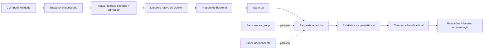

# Evidência, arquitetura e trabalho restante

A avaliação inicial de 2026-10-24 usou a base
`1d46d1bd558cbffddbb359c6ac8ba68f7ec4823b`, com alterações locais preexistentes,
e cobriu somente `inferctl/`. Esta revisão incorpora os registros de host
recebidos em 2026-10-25. O projeto está versionado em
`SamsungBook-Np550xda/Omarchy/calibration/inferctl`; sua instalação e execução
são separadas do instalador de dotfiles. Os testes reais e seus limites estão
em [homologation.md](homologation.md).

## Julgamento de prontidão

Ferramenta inicial para uso pessoal supervisionado. A jornada build → hardware →
plano → benchmark HTTP → relatório está implementada e testada. O produto ainda
não demonstrou seu objetivo final: ganho reproduzível em workload real mantendo
o desktop utilizável. Os testes sintéticos verificam contratos e decisões;
os registros do host acrescentam medições de um modelo pequeno, confirmação de
controles do kernel e integração Docker em CPU. Nenhum desses resultados
comprova qualidade de geração, responsividade real do desktop ou estabilidade
térmica prolongada.

### Estado por fase

| Fase | Implementado | Validação disponível / lacuna |
|---|---|---|
| 1. Hardware | proc/sysfs, topologia, memória, PSI, sensores, DRM/NVIDIA, contadores de storage | Smoke real: i5-1135G7, 4 cores/8 threads, 16.465.260.544 bytes de RAM, Intel DRM, NVMe, 16 sensores. NVIDIA/AMD não exercitados. Throughput observado e latência média de requests vêm dos deltas de diskstats; não medem capacidade máxima nem latência física isolada. Classificação integrada/discreta permanece desconhecida quando não há evidência. |
| 2. LM Studio | REST v1 load/unload com confirmação, SSE, TPS, TTFT de cliente, prompt fixo | Servidor sintético com erros, stream truncado e propriedade de modelo. Protocolo real Qwen3 0.6B Q8 concluído: 2k/4k e baseline final, >120 s por configuração; ver homologation.md. |
| 3. Perfis | JSON estrito, conteúdo do workload, perfis e relatórios separados, mediana/percentis/CI | Persistência e comparação também exercitadas no protocolo real Qwen; identidade de modelo é chave/caminho, sem hash automático de dezenas de GB. |
| 4. Governor | Serviços transitórios, pesos, limites opcionais, nice/ionice, contadores do cgroup, reset | Integração real confirmou CPUWeight, CPU max, limites de memória/swap, nice, mudança de peso e reset. IOWeight indisponível no host, aceito apenas no default neutro; recuperação de crash ainda precisa de teste real. |
| 5. ComfyUI | API workflow, seeds, fila/history, cache inválido, tempo total, unidades declaradas | Smoke de API real com EmptyImage/SaveImage passou, sem inferência. Nenhum workflow de IA executado. Sem tempos separados de CLIP/diffusion/VAE, contagem de offloads ou progresso por step. |
| 6. Docker | Digest obrigatório, volumes persistentes, modelos externos readonly, CPU/RAM/GPU, ownership e cleanup | Integração real CPU passou: imagem local fixada, limites, mounts, torch, persistência e cleanup. GPU e outros runtimes permanecem sem teste. |
| 7. Pareto | Restrições antes da seleção, TPS floor, comparação, intervalo do baseline, refinamento limitado | Testes de regressão e cenários LLM/ComfyUI sintéticos. Não há prova de ótimo global ou joelho de transferências sem métricas de offload. |
| 8. Scheduler | Trava local, admissão RAM/VRAM, fila em processo, CPUWeight explícita para pressão, com dwell de 30s | Máquina de estados testada. Não é fila persistente/daemon de jobs; não mede atividade do compositor. |
| 9. Thermal | Duração sustentada, temperatura, contador de throttle quando disponível, degradação entre metades, teste de quotas | Sem stress térmico real. 120/300 segundos são mínimos de protocolo, não evidência de equilíbrio térmico. |
| 10. Speculative | Main/drafts locais, dois comprimentos, TPS/TTFT/recursos, ganho exigido por intervalos | Parser/seleção testados, sem par main/draft executado. Aceitação não reportada pelo servidor não é inferida. |

Não apresentar estas dez linhas como dez fases homologadas: os gates de integração
real continuam abertos.

## Modelo de execução

O caminho crítico depende de inicialização, carga de modelo, warm-up e requests
sequenciais. A telemetria é concorrente, mas ainda tem custo de CPU e subprocessos;
seu overhead em um modelo real é desconhecido. Um timer separado impede que a
latência do próprio polling NVIDIA seja interpretada diretamente como jitter do
agendador. Ainda é necessário comparar execução com e sem telemetria.

### Custos derivados do código

`n` = candidatos (máximo 64 explícitos); `r` = execuções por candidato (máximo
1000); `s` = bytes de um evento SSE (máximo 4 MiB); `h` = arquivos/dispositivos
consultados por snapshot; `t` = segundos (timeout de no máximo 86400 por candidato).

| Operação | Tempo | Espaço auxiliar | Observação |
|---|---|---|---|
| Snapshot | O(h), mais latência de ferramentas opcionais | O(h) | Telemetria de sensores não é o caminho de inferência; custo local não quantificado. |
| Streaming | O(bytes recebidos) | O(s + tamanho da saída) | Evento limitado; não confundir quantidade de chunks com tokens. |
| Quantis | O(r log r) | O(r) | Copia e ordena; adequado ao limite de 1000 execuções. |
| CI bootstrap | O(2000 × r log r) | O(r + 2000) | Seed fixa; não corrige autocorrelação nem confounding. |
| Frente Pareto | O(n² × d), d ≤ 7 | O(n + d) | Busca exata simples para conjunto pequeno; não justifica índice ou serviço adicional. |
| Experimento | Soma dos tempos reais de carga e inferência | O(r + t + h) | Histórico por request e amostras de jitter limitadas pelo timeout. |

Não há um gargalo de inferência identificado: classificação **UNKNOWN**. O custo
numérico do otimizador não foi demonstrado como relevante para os tempos de
geração. Não foi feita recomendação de paralelizar benchmarks: concorrência entre
candidatos invalidaria o controle de contenção que este produto precisa medir.

## Decisões de projeto e revisão crítica

- Uma interface pequena de backend tem dois casos concretos diferentes: streaming
  de texto e fila/history de imagem. Lifecycle, sistema operacional e seleção
  permanecem fora dela. Nenhum barramento de plugins, ORM, banco ou microserviço.
- JSON com biblioteca padrão reduz instalação e valida campos desconhecidos. O
  custo é não aceitar os exemplos TOML diretamente.
- O(n²) na frente Pareto foi mantido: com 64 candidatos é mais simples auditar do
  que uma estrutura incremental. Não há ganho medido que justifique substituição.
- Pesos relativos são o padrão. MemoryHigh pode provocar reclaim severo; não é
  uma economia gratuita. MemoryMax continua sendo defesa que pode causar OOM do
  próprio workload. Esses valores precisam entrar no benchmark.
- Dados do host e do cgroup têm nomes distintos. Somar RAM de outros processos e
  chamar isso de RAM do modelo seria uma conclusão falsa.
- Campos ausentes ficam ausentes. Sensor térmico desconhecido bloqueia seleção,
  em vez de premiar uma configuração por ter uma temperatura fictícia de 0 °C.
- Uma configuração rápida que viola temperatura ou outra restrição não pode
  elevar o piso do conjunto válido. Um teste detectou esse defeito e o cálculo
  passou a ocorrer depois da filtragem das restrições independentes de TPS.
- Dentro do piso, interactive pode trocar throughput por menor jitter. Esse é um
  compromisso explícito do usuário, não um score com pesos ocultos. O modo batch
  resolve o mesmo conflito escolhendo maior throughput.
- O limite mínimo de duração evita promover um smoke test a ensaio térmico. Não
  certifica equilíbrio térmico: isso depende do hardware e da curva de throughput.

As lentes de custo de execução, representação simples, entrega útil, mecanismos
componíveis e remoção de infraestrutura desnecessária levaram a essas escolhas.
O conflito relevante foi generalidade versus controle de versões: argumentos
nativos permitem experimentos reais, mas não garantem suporte de uma flag ou
qualidade equivalente. Startup inválido é falha e o plano registra os argumentos.
Uma lista universal de flags presumidamente rápidas seria pior evidência.

## Testes locais executados

- `go test -race ./...`: mocks HTTP/SSE, isolamento de credenciais em redirects,
  propriedade/load/unload, recusa de resultados incompletos, seeds/cache, piso de
  TPS, Pareto, sensores ausentes, candidato térmico inválido, serialização de
  admissão, RAM/VRAM desconhecidas, hysteresis, persistência, perfis e Docker argv.
- `go vet ./...` e `go build -trimpath`: verificações de código e build.
- CLI `hardware --interval 200ms`: snapshot e deltas reais, sem alteração do host.
- CLI `calibrate lmstudio ... --dry-run`: plano real gerado sem carregar modelo.
- Teste end-to-end sintético: dois candidatos, warm-up, três requests por candidato,
  baseline final e unload em cada passagem. A recomendação fica vazia em protocolo
  curto. Um backend indisponível deixa relatório de falha.

Não executados: inferência real; benchmarks térmicos; testes de OOM por pressão
real; containers ou unidades transitórias reais; avaliação visual/semântica;
comparação de desempenho antes/depois. Testes unitários não substituem isso.

## Piloto necessário para aceitar uma otimização

1. Sessão Linux real, systemd user ativo e controladores delegados. Verificar os
   valores de cpu.weight, memory.high/max/swap.max no cgroup criado e confirmar
   que Ctrl-C/reset só removem workloads pertencentes ao inferctl.
2. Modelo pequeno que caiba com margem no SamsungBook, contexto/prompt fixos,
   baseline sem quota, threads/batch variados, carga de desktop representativa.
   Medir também responsividade real fora deste programa.
3. Repetir a melhor configuração em outra sessão; observar variabilidade, faults,
   swap-out, temperatura, clocks e degradação ao longo de uma execução mais longa.
   Publicar como otimização só se houver melhora reproduzível e custo conhecido.
4. SDXL ou outro workflow conhecido, imagem fixada, seeds e qualidade iguais;
   comparar headroom/cache/attention separadamente. Instrumentar node timings e
   transferências antes de alegar um joelho de offload.
5. Vídeo e draft models só depois dos casos pequenos. Incluir memória adicional,
   tempos por frame e taxa de aceitação quando instrumentável. Não assumir que
   sucesso em texto curto, CPU ou SDXL se transfere para Wan 14B ou outra GPU.

Interromper o piloto se houver OOM, temperatura crítica, swap além do orçamento ou
falha de cleanup. O programa cancela seus requests e tenta limpar o que possui;
no caso de um servidor externo, o request remoto pode sobreviver ao cancelamento.

## Fontes primárias consultadas

Acesso em 2026-10-24. Conteúdo web acessível; não são resultados de benchmark.
Data de atualização desconhecida onde não indicada. Branches `master` e páginas
`latest` são mutáveis: a compatibilidade do binário instalado precisa ser testada.

| Fonte / instituição | Trecho lido / uso | Versão ou limite |
|---|---|---|
| [systemd resource control](https://www.freedesktop.org/software/systemd/man/latest/systemd.resource-control.html) | CPUWeight/CPUQuota; MemoryHigh/MemoryMax/MemorySwapMax; hierarquia de controladores | Página identificada como systemd 262; não comprova delegação nesta sessão. |
| [Kernel cgroup v2](https://docs.kernel.org/admin-guide/cgroup-v2.html), Tejun Heo | Introdução e restrições hierárquicas | Documento iniciado em outubro de 2015, edição web atual sem commit fixado. |
| [Kernel PSI](https://docs.kernel.org/accounting/psi.html), Johannes Weiner | Interface /proc/pressure e distinção some/full | Documento iniciado em abril de 2018; PSI mede stall, não latência do desktop. |
| [LM Studio load](https://lmstudio.ai/docs/developer/rest/load) | Campos de carga e echo_load_config | REST v1; threads, mmap/mlock e draft não constam desses campos. |
| [LM Studio chat](https://lmstudio.ai/docs/developer/rest/chat) e [streaming](https://lmstudio.ai/docs/developer/rest/streaming-events) | Payload de chat, eventos e stats finais | REST v1; não há seed documentada nesse endpoint; temperature=0 não é garantia universal de determinismo. |
| [LM Studio inventory](https://lmstudio.ai/docs/developer/rest/list) e [unload](https://lmstudio.ai/docs/developer/rest/unload) | Chave de modelo, loaded_instances, instance_id | API atual; unload explicitamente por instância. |
| [ComfyUI routes](https://docs.comfy.org/development/comfyui-server/comms_routes) | prompt, queue, history, stats, free/interrupt | API local; interrupt global é inadequado para cancelar arbitrariamente outros clientes. |
| [ComfyUI CLI](https://github.com/Comfy-Org/ComfyUI/blob/master/comfy/cli_args.py) e [execution](https://github.com/Comfy-Org/ComfyUI/blob/master/execution.py) | VRAM/headroom, cache, attention; caches none/LRU/classic/RAM | master; suporte varia com build, PyTorch e custom nodes. |
| [llama.cpp server](https://github.com/ggml-org/llama.cpp/blob/master/tools/server/README.md) | Threads, contexto, timings, flags atuais de draft | master; flags antigas de draft foram removidas. Não inventar compatibilidade entre versões. |
| [Docker resource constraints](https://docs.docker.com/engine/containers/resource_constraints/) | Limites CPU/memória/swap e riscos de OOM | Documentação atual; suporte depende de kernel/runtime. |

A pesquisa foi limitada aos contratos que mudam a implementação. Não procurou
provar um vencedor universal de threads/cache/attention: isso exige o piloto local.
