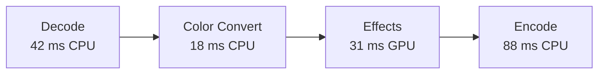

# Algorithmic Project Review

Explain how the project transforms its inputs, where work and memory grow, where CPU, memory, GPU, I/O, synchronization, and data movement are spent, and which changes would materially improve it. Judge implementation choices in the context of the actual workload rather than treating lower Big-O notation or higher resource utilization as automatic evidence of a bottleneck.

## Operating boundary

The audit is read-only. Inspect source, configuration, tests, documentation, version history, and available runtime evidence; run safe existing tests, benchmarks, profilers, or representative commands when proportionate. Do not edit code, install dependencies, generate persistent project artifacts, or execute untrusted or production-affecting workloads unless the user separately authorizes that action.

Avoid turning this into an exhaustive style review. Mention naming, abstraction, or architecture only when they obscure algorithmic behavior, duplicate work, prevent measurement, or materially increase implementation risk. Treat security and correctness issues as important when discovered, but recommend a dedicated review if either becomes the dominant concern.

## Establish the model

1. Identify the project's purpose, important entry points, execution model, and expected workload.
2. Define the independent input variables before using asymptotic notation. For example, distinguish records `n`, edges `m`, query count `q`, payload bytes `b`, and concurrency `c` rather than hiding them all inside `n`.
3. Trace the critical data flow from input through transformations, storage, CPU/GPU work, external calls, and output. Include database, filesystem, network, serialization, scheduler, accelerator, and framework work when they dominate the path.
4. State material unknowns such as data distribution, maximum size, latency target, memory budget, mutation frequency, hardware, GPU model, deployment constraints, or expected concurrency. Use scenarios instead of inventing requirements.

For a large project, prioritize user-specified paths, hot paths supported by evidence, core domain algorithms, and operations whose cost scales with external input. Explain the inspected scope; do not imply complete coverage from a sample.

## Build an execution-cost graph

When runtime behavior matters, model the relevant path as a directed graph.

A node may represent a function, algorithm, pipeline stage, task, thread operation, coroutine, query, filesystem operation, network operation, codec stage, rendering pass, or GPU kernel. An edge represents a dependency, transfer, synchronization event, queue, or producer/consumer relationship.

Annotate measurable nodes with relevant values such as:

- wall time;
- CPU time;
- exclusive and inclusive time;
- wait and queue time;
- CPU utilization and per-thread utilization;
- allocations, allocation rate, RSS and peak RSS;
- memory bandwidth and page faults;
- L1/L2/LLC misses and IPC when hardware counters are available;
- GPU execution time, utilization, occupancy, VRAM, queue wait, and kernel duration;
- CPU-to-GPU and GPU-to-CPU transfer time and bytes;
- bytes read and written, I/O latency and throughput;
- lock contention, context switches, scheduler delay, and queue depth.

Do not require every metric when the platform cannot expose it. Mark unavailable measurements explicitly rather than inventing them.

Represent the graph in Mermaid when useful. Example:



The graph is a model of observed execution, not decorative documentation. Keep node boundaries aligned with decisions that can actually be optimized or reasoned about.

## Analyze implementation

Read [references/analysis-method.md](references/analysis-method.md) and apply the relevant checks.

For each important operation:

- describe the algorithm in plain language;
- identify the data structures and the invariants they maintain;
- derive time and auxiliary-space complexity from the code, naming all relevant variables;
- distinguish worst-case, expected, average, amortized, and output-sensitive bounds when the distinction matters;
- include preprocessing, allocation, copies, recursion depth, retained memory, result size, synchronization, and data movement;
- note assumptions required for the bound, such as hash behavior, balanced trees, sorted inputs, cache policy, bounded key size, GPU residency, or independent tasks;
- connect the analysis to concrete file and line evidence.

Analyze composition rather than labeling isolated loops. Sequential phases add, nested dependent work multiplies, early exits change best-case behavior, parallel branches do not simply add to wall time, and calls hidden behind library or ORM APIs still have costs. Do not drop meaningful variables or constants merely to make the expression look simpler.

## Find the critical path

When tasks overlap or execute concurrently, distinguish aggregate resource use from end-to-end latency.

Find the longest dependency path that determines completion time. Do not sum parallel branches as if they were serial.

Example:

```text
       +-- B: 100 ms --+
A:20ms                D:30ms
       +-- C: 40 ms ---+
```

If B and C execute concurrently, latency is approximately:

```text
20 + max(100, 40) + 30 = 150 ms
```

The critical path is `A -> B -> D`, not the sum of all node times.

Where measurements allow it, report each critical-path node's contribution to end-to-end latency.

## Build a timeline when concurrency matters

When threads, GPU work, asynchronous I/O, or queues overlap, build a temporal view that makes idle gaps and serialization visible.

Example:

```text
time ---------------------------------------------------->
CPU0  [decode########][filter###]       [encode########]
CPU1      [decode######]                [encode######]
GPU                       [effect###############]
I/O   [read#####]                         [write####]
```

Use this to detect pipeline bubbles, starvation, synchronization, queue waits, and unnecessarily serialized work.

## Validate likely bottlenecks

Separate four claims:

- **theoretical risk:** growth rate or pathological behavior inferred from implementation;
- **observed bottleneck:** measured cost under a described workload;
- **critical-path bottleneck:** measured work that controls user-visible latency or throughput;
- **projected bottleneck:** likely future constraint based on an explicit scale or post-optimization assumption.

High resource use is not automatically a bottleneck. A stage using 95% CPU for 20 ms may matter less than a GPU or I/O stage that makes the application wait 120 ms.

Use existing performance evidence first. When safe and useful, run a representative benchmark or profiler with controlled inputs, note the environment and command, repeat enough to detect obvious noise, and avoid presenting microbenchmark results as end-to-end behavior. Never claim that a code path is slow solely because its asymptotic bound looks unfavorable at input sizes the project will not encounter.

Classify material bottlenecks only when evidence supports the label. Useful categories include:

- `HOT_CPU`
- `MEMORY_BOUND`
- `CACHE_BOUND`
- `GPU_BOUND`
- `IO_BOUND`
- `SYNC_BOUND`
- `LOCK_CONTENTION`
- `ALLOCATION_HEAVY`
- `TRANSFER_BOUND`
- `SERIALIZATION_BOTTLENECK`
- `UNDERUTILIZED_PARALLELISM`
- `SCHEDULER_BOUND`
- `LATENCY_BOUND`
- `BANDWIDTH_BOUND`
- `UNKNOWN`

For each classification, state the measurements that justify it and a confidence level: **high**, **medium**, **low**, or **speculative**.

## Analyze data movement

Treat moving data as real work.

Track relevant copies, serialization, deserialization, format conversion, CPU/GPU transfers, filesystem movement, and network movement. Highlight redundant round trips and transformations.

Distinguish memory capacity, allocation overhead, cache/locality, and memory-bandwidth problems. They are different failure modes and should not receive the same recommendation.

## Analyze parallelism without worshipping it

Determine dependencies before recommending more threads or GPU execution.

Identify:

- truly serial work;
- unnecessarily serialized work;
- task parallelism;
- data parallelism;
- synchronization cost;
- scheduler overhead;
- GPU-suitable work;
- work that is parallelizable but still unsuitable for the GPU because transfer, launch, branching, or workload size dominates.

Never recommend "move it to the GPU" or "add threads" merely because the operation can theoretically run in parallel.

## Find improvements

For a material algorithm or data-structure recommendation, search current primary sources online (papers, official documentation, or maintained implementations) for credible alternatives and their stated assumptions. Check publication or update dates, implementation maturity, and whether the claimed advantage applies to this workload. Record direct links and dates for the sources behind a recommendation. Use memory to form search terms, not as evidence that the known options are still the best ones. If online access is unavailable, mark the comparison provisional rather than implying the search happened.

Test promising alternatives against the existing baseline when a bounded, read-only experiment is feasible. Use the same inputs and correctness oracle, include representative and adverse cases, measure the relevant end-to-end cost and resource use, and repeat noisy measurements. A small disposable prototype is acceptable; preserve the audit's no-project-edits boundary. Report the inputs, environment, command, results, and limitations. Published benchmarks motivate a local test but do not establish a gain here. If testing is infeasible, provide a concrete experiment and label the expected gain unverified.

Consider changes in this order:

1. eliminate unnecessary work, repeated scans, duplicate queries, conversions, copies, transfers, or recomputation;
2. choose a better algorithm or exploit a domain constraint;
3. choose a data structure matching lookup, update, ordering, locality, and memory needs;
4. batch, stream, index, cache, precompute, or parallelize where the workload supports it;
5. tune low-level constants only when measurement shows they matter.

For every recommendation, explain the current behavior, proposed change, expected complexity or operational effect, supporting evidence, and tradeoffs. Include memory, correctness, determinism, maintainability, concurrency, invalidation, and dependency costs where relevant. Prefer a smaller, safer change when it captures most of the benefit.

Do not recommend optimization that lacks a plausible workload, preserves no required invariant, or merely exchanges one bottleneck for another. Do not describe speculative improvements as measured gains. When the current implementation is already appropriate, say so.

## Project optimization impact and next bottleneck

Estimate whole-system impact before prioritizing an optimization.

If a stage consumes a known fraction of total execution time, use Amdahl's Law or an equivalent dependency-aware estimate rather than assuming a local 2x speedup makes the application 2x faster.

After estimating a change, identify the likely next bottleneck. Example:

```text
Current bottleneck: encode, 44% of runtime
Projected encode improvement: 50%
Projected next bottleneck: decode
Projected total speedup: 1.28x
```

Do not present projected numbers as measured results.

## Scheduled analysis mode with cron

Normal use is one-shot. Enter scheduled mode only when the user explicitly asks this skill to run repeatedly, periodically, automatically, continuously, on a schedule, or as a loop.

On Unix-like systems where `cron` and `crontab` are available, use the operating system scheduler instead of keeping an agent, shell loop, terminal, tmux session, profiler wrapper, or long-lived process alive.

A recurring analysis must execute as:

```text
cron -> one bounded analysis -> persist measurements/state -> exit
```

Never implement recurring execution with `while true`, repeated `sleep`, recursive self-invocation, or an AI process intentionally kept alive between runs.

### Install the scheduled job safely

When scheduled execution is requested:

1. Resolve the project root, requested analysis scope, cron expression, target workload, and the actual agent CLI used to invoke this skill non-interactively.
2. Verify `cron`/`crontab` availability and verify the CLI's real non-interactive invocation. Do not invent flags or assume an interactive command works under cron.
3. Create a small per-task runner outside the project, preferably under `~/.local/bin/` or an XDG data directory. Use absolute paths and explicitly set `HOME`, `PATH`, working directory, and required environment because cron has a minimal environment.
4. Store state and logs under `~/.local/state/skills/algorithmic-project-review/<task-id>/` or the corresponding XDG state directory.
5. Use `flock` when available to prevent overlapping analyses. If a previous run still holds the lock, record the skipped run and exit instead of launching another expensive profiler.
6. Install a managed crontab block with stable ownership markers:

```cron
# BEGIN skill-loop:algorithmic-project-review:<task-id>
<expression> <absolute-runner-path>
# END skill-loop:algorithmic-project-review:<task-id>
```

7. Read and preserve unrelated user crontab entries exactly. Updating a task must replace its managed block rather than append another entry.
8. Capture stdout, stderr, exit status, start/end timestamps, revision, workload identity, and environment details needed to compare measurements.
9. Make setup idempotent and provide a clear way to inspect, disable, update, and remove the managed entry.

If cron is unavailable, report that cron scheduling cannot be installed on the current system. Do not silently substitute systemd timers, launchd, Task Scheduler, or another scheduler unless the user explicitly requests an alternative.

### Scheduled measurement discipline

Persist enough state to compare runs meaningfully. At minimum record:

- analyzed revision or commit;
- timestamp;
- workload or input identity;
- hardware and relevant runtime versions;
- wall time and the primary resource measurements used by the report;
- detected bottleneck classifications;
- critical path when available.

Do not compare measurements as regressions when the workload or environment changed materially without stating that limitation.

For repository-backed work, persist the last successfully analyzed revision. If the repository and configured workload have not changed, skip expensive profiling unless the scheduled task explicitly requests periodic remeasurement.

When a new revision exists, prefer analyzing the changed paths and affected execution graph first, then widen the scope when evidence indicates the critical path moved elsewhere.

### Regression detection

When comparable historical runs exist, calculate meaningful deltas and distinguish noise from likely regressions. Record before/after values and variance where available. Do not declare a regression from a single noisy run when repeated measurements are practical.

Scheduled mode remains read-only unless the user separately authorizes implementation. Detecting a performance regression does not authorize editing code, committing changes, opening PRs, or deploying fixes.

## Report

Use [references/reporting.md](references/reporting.md). Lead with the execution paths and variables that dominate scaling, then rank findings by likely impact, evidence strength, and effort. Keep correctness defects separate from performance improvements so urgency is not confused with speed.

When runtime evidence is available, include:

- execution-cost graph;
- critical path;
- timeline when concurrency matters;
- CPU, RAM, GPU/VRAM, I/O, synchronization, and transfer summary as applicable;
- evidence-backed bottleneck classifications;
- wasted work and data movement;
- justified parallelism opportunities;
- ranked optimization candidates;
- projected system-level impact;
- likely next bottleneck;
- missing measurements and confidence.

## Completion standard

The audit is complete when the user can see what was inspected, how the core implementation works, which input dimensions determine time and memory, where CPU/RAM/GPU/I/O time actually goes when measured, which dependency path controls the result, where conclusions are derived versus measured, which current choices are sound, and which few improvements have the strongest evidence and best tradeoff. If missing workload information prevents meaningful prioritization, return the valid complexity analysis and a concrete measurement plan rather than fabricating a bottleneck.

For scheduled mode, one iteration is complete when the configured scope has been measured or analyzed, comparable state has been persisted, logs have been closed, and the process exits cleanly.
